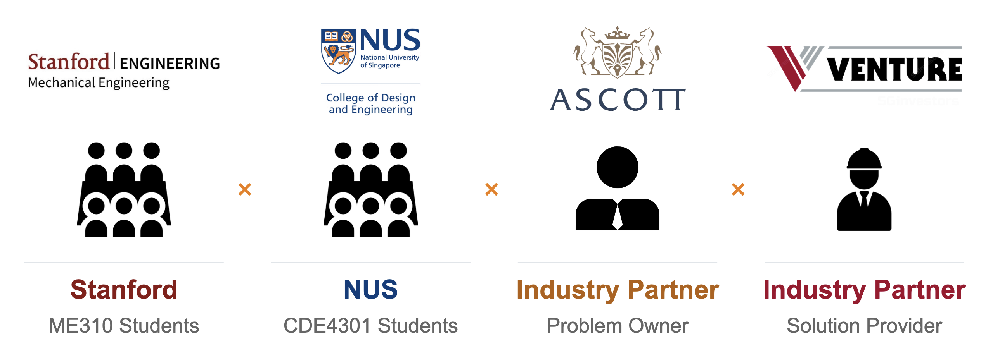

## 1. Introduction {#introduction}

### Background {#background}

This report documents the work of Team IS-431 under CDE4301 Innovation and Design Capstone at the National University of Singapore (NUS), conducted as part of the Stanford Global Engineering Design Innovation (GEDI) programme in AY2026/27. The project is carried out with The Ascott Limited as industry partner and problem owner, and begins from a deliberately open challenge:

> **How can we reimagine the hotel arrival experience with AI and Emerging Technologies?**

We framed this challenge under the theme of *Invisible Hospitality*: the idea that the best service is one the guest barely notices, because the routine parts of arrival (confirming who they are, paying, getting into the room) happen smoothly in the background, leaving staff free to offer the personal touch that guests actually remember.

The project runs in two phases. **Phase I** (this report) covers preliminary research, ground work in hotels, and the first prototype. **Phase II** continues the work with Stanford's ME310 course, with students from both universities and industry partners working together over three sprints: understanding the problem space, prototyping in several directions, and refining a final integrated prototype. The collaboration brings together Stanford ME310 students, NUS CDE4301 students, Ascott as the problem owner, and Venture as a solution provider.

<figure markdown="1">
  
  <figcaption>Phase II collaboration: Stanford ME310 and NUS CDE4301 students working with Ascott (problem owner) and Venture (solution provider).</figcaption>
</figure>

### Project scope and objectives {#project-scope}

"Arrival" touches many parts of a hotel stay, from pre-arrival messaging to luggage handling to key issuance, and the set of "emerging technologies" that could be applied to it is wider still. Early in Phase I we therefore narrowed the question to a single, concrete problem: **how hotels can improve the check-in experience through better kiosk implementation**. Chapter 3 explains why we made this choice.

Within that scope, Phase I set out to:

1. **Understand the landscape**: how Singapore hotels operate across market segments, what pressures they face (notably manpower), and what the government and technology vendors are doing about it.
2. **Understand what happens on the ground**: visit hotels that already use check-in kiosks, observe how guests and staff interact with them, and identify why some deployments succeed and others do not.
3. **Deliver a useful prototype**: a tool that helps hotel decision-makers act on those findings, validated with at least one hotel practitioner.
4. **Lay the groundwork for Phase II**: identify what we have learned, what we have not yet been able to test, and how the Phase I outcomes feed the next stage.

The report concentrates on the **check-in** step of arrival and on **self-service kiosks** as the technology. Check-out, mobile or fully contactless check-in, and the rest of the guest stay are outside the scope of Phase I, although the broader arrival experience returns as the focus of Phase II.

### Organisation of this report {#report-organisation}

- **Chapter 2 (Context)** describes the Singapore hospitality landscape, its manpower challenges, stakeholders, and digitalisation initiatives.
- **Chapter 3 (Problem Statement)** explains how the original challenge was refined into the problem we address.
- **Chapter 4 (Research)** reviews existing kiosk technology, industry practice, and evidence on kiosk adoption.
- **Chapter 5 (Fieldwork)** presents our hotel visits, observations, and the findings that shaped the solution.
- **Chapter 6 (Prototype Development)** explains why we built an interactive implementation playbook, how it is structured, and presents the playbook itself.
- **Chapter 7 (Evaluation)** reports feedback from hotel practitioners and the limitations of the current prototype.
- **Chapter 8 (Conclusion)** summarises Phase I and outlines the way ahead for Phase II.
