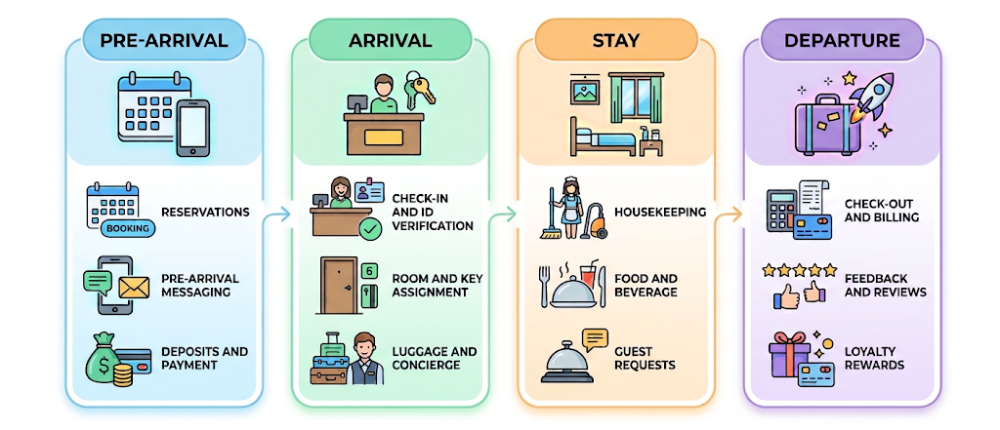
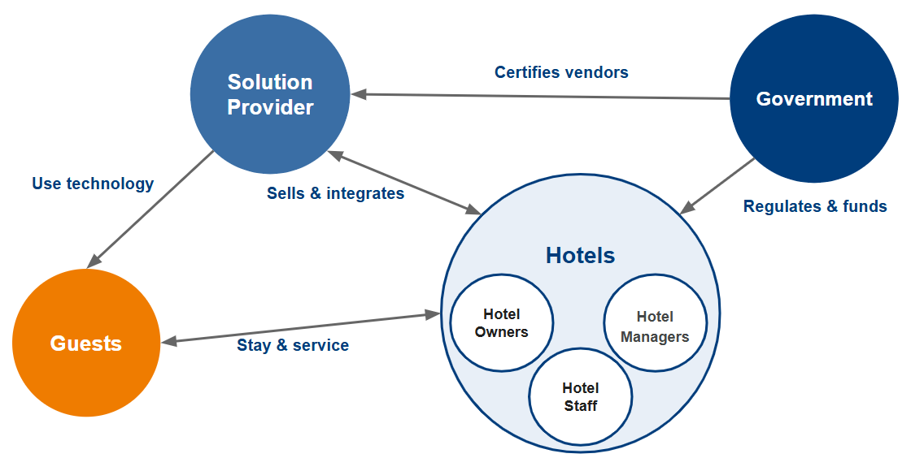
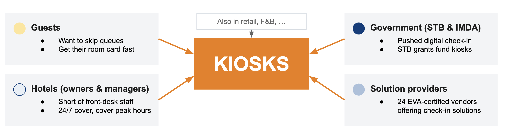

## 3. Research and Problem Investigation {#research}

### Singapore's hospitality landscape {#hospitality-landscape}

#### Hotel sector overview

Singapore's hotel sector spans three broad segments: **luxury** (for example Raffles, Mandarin Oriental, Shangri-La and The Ritz-Carlton), **mid-range** (for example Novotel, Holiday Inn and Hilton Garden Inn, and serviced-residence brands such as Citadines, Somerset and Oakwood), and **budget** (for example lyf, Hotel 81 and ibis budget). Large groups such as The Ascott Limited operate brands across several of these tiers. The segments differ in guest profile, service expectations, margins and staffing models, so a solution that suits a luxury property is not automatically right for a budget one. This became a recurring consideration in how we framed our eventual prototype.

Despite these differences, every hotel delivers the same core service chain of pre-arrival, arrival, stay and departure:

Our work focuses on **arrivals**, which is the first moment a guest interacts with the hotel in person. It is also the stage that combines the most routine, rule-bound tasks (verifying identity, collecting payment, issuing a key) in a single, time-pressured transaction at the front desk.

#### Defining a good hotel arrival experience

To establish a benchmark for a good hotel arrival experience, we referred to **ISO 22483:2020, *Tourism and Related Services — Hotels — Service Requirements***. The standard outlines expectations for front desk operations and guest service, including clear reception signage, effective communication, prompt and courteous assistance, accessibility considerations, and security procedures. Collectively, these requirements suggest that a positive arrival experience extends beyond a quick check-in process; guests should also be able to obtain necessary information and receive appropriate assistance throughout their arrival.

These principles provide a reference point for evaluating the existing guest journey and identifying areas where the arrival experience could be improved, forming a foundation for our subsequent analysis of guest pain points and opportunities for improvement.

### Tourism demand and manpower challenges {#manpower-challenges}

#### Rising demand

Global tourism has fully rebounded, with around 1.4 billion international tourist arrivals in 2024, or 99% of pre-pandemic levels (UN Tourism, 2025). According to the Singapore Tourism Board (STB, 2026c), Singapore welcomed **16.9 million visitors** and a record **S$32.8 billion in tourism receipts** in 2025, and is targeting S$47–50 billion by 2040. For hotels, this growth means sustained pressure on front-of-house services such as check-in and check-out.

#### A shrinking labour supply

Labour supply has not kept pace. In June 2025, Singapore's accommodation sector had a **job vacancy rate of 6.5%**, more than double the economy-wide rate of 3.0%, rising to **8.4% for clerical, sales and service roles** such as front-desk staff (Ministry of Manpower [MOM], 2025). Employers report that resident job seekers avoid hard-to-fill service roles because they find the work physically strenuous (42.9%), the hours long (39.1%) and the pay unattractive (37.4%) (MOM, 2026b). Low occupational status, limited recognition and verbal abuse from guests compound the problem (Cayla, 2023), and locals often remain uninterested even when wages rise (Seah, 2022).

Foreign labour offers limited relief. The services-sector foreign-worker quota has been tightened from 50% to **35% of a firm's workforce** (MOM, n.d.; Seah, 2022), and the minimum qualifying salary for new S Pass holders rises to **S$3,600 from January 2027**, with a further rise to around S$4,000–4,500 expected by 2030 (MOM, 2026a). Hotels are therefore hiring largely at entry level: about **two-thirds of accommodation vacancies require one year of experience or less** (MOM, 2026b), placing a heavy, recurring burden on training and service consistency.

#### A widening gap

Demand and labour supply are therefore moving in opposite directions. The World Travel & Tourism Council (WTTC, 2025) projects that by 2035 the global hospitality workforce will fall about **18%, or 8.6 million workers, short of requirements**. Singapore is likely to feel this more acutely, as resident workforce growth is slowing and labour force participation is already high (MOM, 2025). Understaffed hotels face slower and less consistent service, which erodes guest satisfaction (Seah, 2022).

<!-- TODO: insert the chart of the hospitality industry's top challenges and priorities (referred to as Figure 3 in the source draft). -->

The global hospitality industry faces a structural workforce crisis that is likely to worsen, and Singapore, with its relatively expensive labour force, will be doubly affected. There is therefore a real and pressing need for solutions that ease this pressure, particularly at labour-intensive touchpoints such as the front desk.

### Regulatory context for check-in {#regulatory-context}

Check-in in Singapore is not only a service step but a **regulated one**. Hotels are required to verify the identity and permitted stay of international visitors. The Singapore Tourism Board (STB) provides the **E-Visitor Authentication (EVA)** system, an API designed to streamline the hotel check-in process (STB, 2026b) by automating verification of a visitor's stay validity against Immigration and Checkpoints Authority (ICA) records. In an EVA-enabled check-in flow, the passport is scanned and a live face capture is matched against the passport photo. Hotels without EVA must carry out this check manually.

This makes check-in a particularly strong candidate for automation in Singapore: the verification is mandatory, repetitive and rule-based, and it requires a physical presence at the property (a live face capture and a physical key), which means it cannot simply be replaced by a mobile app in the way that, for example, cinema ticketing has been.

### Government and industry push {#digitalisation-push}

Government agencies are actively encouraging digital check-in:

- STB's EVA-Ready Programme lists **24 recognised vendors** whose digital check-in solutions are compatible with EVA (STB, 2026b), and more than **70% of Singapore's hotel room stock** has already adopted digital check-in/check-out solutions integrated with EVA (Yue, 2025).
- The **Hotel Industry Digital Plan**, introduced by IMDA and STB in 2019 and refreshed in 2025, pushes hotels to adopt five key technologies: smart rooms, robotics, digital concierge, digital check-in and check-out, and asset management systems (Yue, 2025).
- Funding support is available through STB's **Business Improvement Fund**, whose qualifying costs include hardware, equipment and software, with different levels of support for SMEs and non-SMEs (STB, 2026a).

### Stakeholders {#stakeholders}

Four groups have a stake in how check-in is done, and their interests increasingly point in the same direction. The government certifies vendors and regulates and funds hotels; solution providers sell and integrate technology into hotels; and guests use that technology as part of their stay and service. Within hotels, owners and managers are distinct decision-makers.

<figure markdown="1">
  
  <figcaption>Stakeholder map for hotel check-in technology.</figcaption>
</figure>

| Stakeholder | What they want | Relationship to kiosks |
|---|---|---|
| **Guests** | Skip queues, get the room card quickly, avoid repeated form-filling | Use the kiosk (or choose not to) |
| **Hotels (owners and managers)** | Cover 24/7 operations and peak hours despite a front-desk staff shortage; verify every guest; protect profit | Decide whether, where and how to deploy |
| **Government (STB, IMDA)** | Productivity and digital adoption in the sector | Regulate, certify vendors and fund adoption |
| **Solution providers** | Sell and integrate check-in solutions | Supply and maintain the hardware and software |

### Why kiosks {#why-kiosks}

Across the stakeholder map, one solution recurs: the **self-service kiosk**. Guests want to skip the queue; hotels are short of front-desk staff and need peak and round-the-clock cover; the government pushes and funds digital check-in; and a certified vendor market exists to supply it.

<figure markdown="1">
  
  <figcaption>Each stakeholder group's needs converge on kiosks, which are also established in other industries such as retail and F&amp;B.</figcaption>
</figure>

Kiosks also offer a targeted response to the manpower challenges described above. Front-desk staffing comes in whole units: a desk sized for peak arrivals is under-used for much of the day, while one sized for average demand is overwhelmed at peak. Arrival surges, such as an aircrew of 20–30 checking in at once, are a problem of **concurrency rather than total volume**, which parallel self-service stations are well suited to absorb. By standardising routine transactions, kiosks also reduce reliance on a largely entry-level workforce and free limited staff for interactions that benefit from a human touch.

Self-service has also delivered results in other industries. McDonald's reported higher average checks at its self-order kiosks, as customers browse the menu for longer, feel less pressure and tend to spend more (Wong, 2015). Changi Airport's passport-less immigration clearance, fully rolled out across all four terminals on 30 September 2024, cut average clearance time per traveller by 60%, from 25 seconds to 10 (Immigration & Checkpoints Authority [ICA], 2024). Uniqlo reports that its RFID self-checkouts reduce checkout waiting times by about 50% (FashionUnited, 2024).

Technology alone will not resolve the manpower crisis, and automation can make service work less visible and less valued (Cayla, 2023). We therefore position kiosks as a **complement to front-line staff rather than a replacement**.

The question that motivated our project, then, is not *whether* kiosks make sense for hotels, but a more difficult one: **how well are they actually working, and what can we learn from the hotels that have already adopted them?**

### Understanding guest perspectives on self-service kiosks {#guest-perspectives}

Having established the case for kiosks from the perspective of hotel owners and managers, we turned to guests, whose uptake ultimately determines whether kiosks deliver their intended savings. In a study of 163 hotels, Lui and Piccoli (2010) found that kiosks improved financial performance only when guests used them successfully, and that failed self-service check-ins reduced guests' willingness to pay and to return.

#### Approach {#guest-approach}

Rather than surveying our own networks, which would not reflect the demographics of hotel guests, we adopted a **netnographic approach**, analysing unsolicited discussions in online travel communities (Kozinets, 2002). This gave us access to travellers of different ages, regions and travel purposes. We reviewed contributions from approximately **100 users** across the Tripadvisor Business Travel forum (*What Do You Think*, n.d.), Australian Frequent Flyer (Mattg, 2024), Reddit's r/askhotels (*Why Is It Hotel Self-Check-In Kiosk Not Popular*, n.d.) and Singapore's HardwareZone forums (*Genting FAQ*, n.d.), and grouped recurring comments into six themes.

Because forum users are likely to be more tech-savvy and to travel more often than the average guest, and dissatisfied guests may be over-represented, we treat the findings as **exploratory**.

#### Findings {#guest-findings}

**Theme 1: Reliability.** Technical failure was the most common complaint. Users described frozen screens, bookings that could not be found, kiosks retaining passports, and keys that were not issued or did not work. One user vowed never to use a kiosk again, and two felt staff blamed them for the failure (*What Do You Think*, n.d.). Mobile check-in drew similar criticism, with guests forced to repeat the process at the desk (Mattg, 2024). This matches Meuter et al.'s (2000) finding that technology and process failures are leading causes of dissatisfaction with self-service technologies (SSTs).

**Theme 2: Recognition and human contact.** Loyalty members reported that kiosks could not apply points or issue breakfast vouchers despite displaying their elite status, whereas staff could offer complimentary extras (Mattg, 2024). Guests also relied on the desk for questions about facilities and directions (*Why Is It Hotel Self-Check-In Kiosk Not Popular*, n.d.). Lui and Piccoli (2010) similarly found that guests continued to use the front desk for consultation, and a high "need for interaction" is known to reduce the appeal of self-service (Dabholkar & Bagozzi, 2002).

**Theme 3: Segment and travel purpose.** Support came mainly from frequent and business travellers keen to avoid "meaningless chitchats" with staff (*What Do You Think*, n.d.), while others expected upmarket hotels to offer both options so guests could choose according to their trip purpose (Mattg, 2024). Japan was often cited as a market where kiosks are already normal. This reflects the importance of compatibility with travellers' needs (Kim & Qu, 2014) and managers' view that SSTs suit business-oriented, non-luxury properties (Liu & Hung, 2021).

**Theme 4: Privacy and identity verification.** Some guests regarded facial capture at kiosks such as those at Swissôtel The Stamford as "a breach of privacy" (Mattg, 2024), while Genting's reliance on passport NFC chips forced some guests to queue for manual overrides (*Genting FAQ*, n.d.). Research on hotel guests in Singapore shows that privacy concerns heighten the perceived risk of facial recognition check-in (Boo & Chua, 2022), and that privacy influences trust more strongly than security does (Xu et al., 2021).

**Theme 5: Mobile-first and hybrid journeys.** Many contributors preferred app check-in with mobile keys to lobby kiosks (*Why Is It Hotel Self-Check-In Kiosk Not Popular*, n.d.). Suggested hybrids included using kiosks only to dispense keycards where doors lack mobile-key readers, and an express lane for guests who had checked in online. At Genting, guests used the app to reserve a room before arrival, reducing the kiosk step to under three minutes (*Genting FAQ*, n.d.). This supports treating kiosks as one channel within a complementary portfolio (Lui & Piccoli, 2010; Piccoli & Lui, 2014).

**Theme 6: Usability anxiety and fairness.** Some guests feared making mistakes or could not find their reservation number, whereas the desk needed only a passport (*Why Is It Hotel Self-Check-In Kiosk Not Popular*, n.d.). Others resented doing the hotel's work without any benefit to themselves, or worried about job losses (Mattg, 2024). These concerns reflect the discomfort and insecurity associated with lower technology readiness (Parasuraman, 2000) and the importance of ease of use in kiosk acceptance (Kim & Qu, 2014).

*Summary of guest themes and design implications*

| Theme | What guests reported | Implication for kiosk design |
|---|---|---|
| **1. Reliability and failure recovery** | Non-working keys, frozen screens, bookings not found, kiosks retaining passports; guests made to feel at fault | Treat reliability as a prerequisite; provide a staffed fallback and a blame-free hand-off |
| **2. Recognition and human contact** | Loyalty benefits and vouchers not applied; questions about rooms and facilities unanswered | Integrate loyalty data; keep staff available for questions and recognition |
| **3. Segment and travel purpose** | Frequent and business travellers favour speed; leisure and luxury guests expect a choice | Match the kiosk's role to hotel positioning and guest mix |
| **4. Privacy and identity verification** | Discomfort with facial capture; dependence on passport NFC chips | Explain data use clearly; offer non-biometric alternatives |
| **5. Mobile-first and hybrid journeys** | Preference for app check-in and mobile keys, with the kiosk as key dispenser or fallback | Design the kiosk as one touchpoint in an end-to-end journey |
| **6. Usability anxiety and perceived fairness** | Fear of making mistakes; lost reservation numbers; resentment at unrewarded "self-labour"; job concerns | Minimise required inputs; make the guest benefit explicit |

#### Key insights {#guest-insights}

Together, these findings carry five implications for kiosk design:

1. **Adoption is conditional.** Guests rarely reject the concept, but a single failure can end their use, so reliability and blame-free recovery are prerequisites rather than operational details.
2. **Kiosks should complement the front desk**, which retains roles in recognition and consultation.
3. **Receptiveness varies by segment**, so deployment should reflect a property's positioning and guest mix.
4. **Kiosks work best as one touchpoint in a mobile-first journey** that carries loyalty data through to arrival.
5. **Verification methods must be transparent**, with non-biometric alternatives for guests who decline (Boo & Chua, 2022).

These guest-side findings echo what we observed on the ground (Chapter 4), where failed bookings, jammed key dispensers and unnoticed kiosks undermined adoption, and they informed the design principles in our playbook (Chapter 5).

