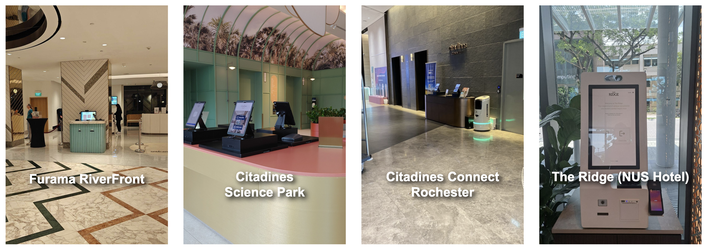
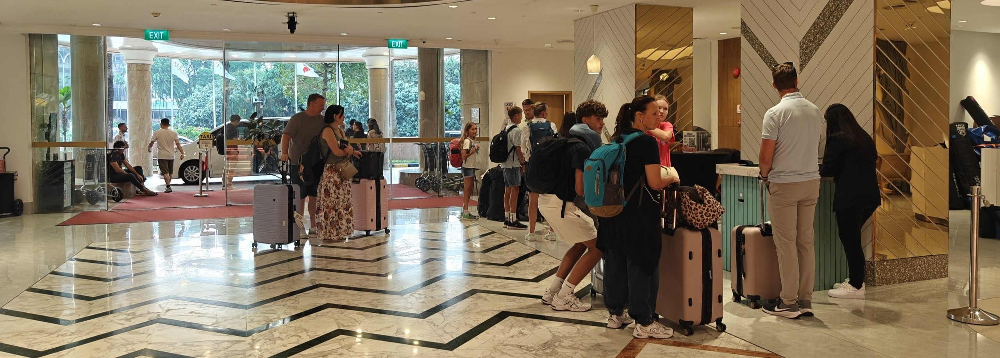
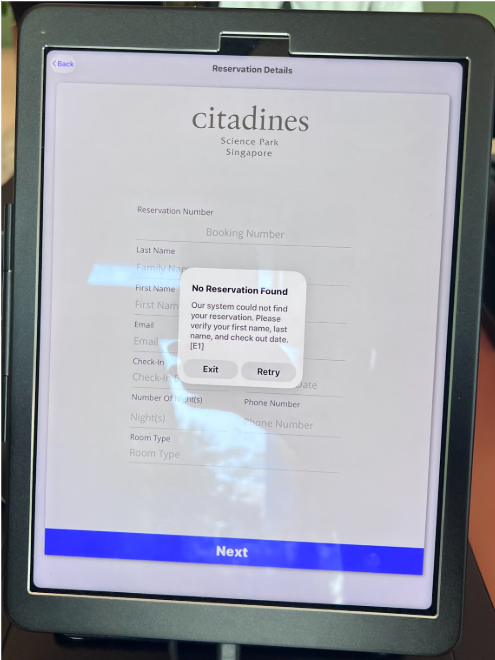

## 4. Fieldwork and Key Findings {#fieldwork}

### Hotel visits {#hotel-visits}

As part of our ground work, we visited four hotels: Furama RiverFront, Citadines Science Park, Citadines Connect Rochester and The Ridge (NUS Hotel), and observed arriving guests' experience of the check-in kiosks.

<figure markdown="1">
  
  <figcaption>Kiosk deployments in the lobbies of the four hotels visited. Photos: IS-431 Team.</figcaption>
</figure>

### Observations and synthesis {#fieldwork-synthesis}

This chapter will present hotel visits, observation methods, kiosk-related challenges, adoption differences, and synthesis of findings. It will explain how these findings motivated a broader implementation-focused solution rather than simply redesigning kiosk hardware. # Will be removed later

Below are our key findings from each hotel visited:

| Hotel | Observation |
|---|---|
| **Furama RiverFront** | Staff members were using kiosks instead of the guests themselves, which was equivalent to a traditional front-desk check-in. Families were observed to be waiting in line as well, meaning the kiosks had no added benefits and were not being used efficiently. |
| **Citadines Science Park** | Check-in kiosks were placed immediately in front of the entrance, while the front-desk was at a higher floor. One of the new guests checking in had a booking identification issue (a critical functional failure) and eventually went upstairs to check in at the front desk. |
| **Citadines Connect Rochester** | The kiosks were placed right next to the elevator due to port limitations, which was out of guests' immediate view upon entering the hotel. Furthermore, during a demonstration of the kiosk check-in, the key card dispensing had failed - this was identified as another pain point of the entire process. |
| **The Ridge** | Although placed against the entrance and not immediately visible to guests entering, staff members were trained to guide/escort the guests to the check-in kiosks. |

<figure markdown="1">
  
  <figcaption>Long queue for kiosk check-in at Furama RiverFront. Photo: IS-431 Team.</figcaption>
</figure>

<figure markdown="1">
  
  <figcaption>Kiosk check-in failure at Citadines Science Park. Photo: IS-431 Team.</figcaption>
</figure>