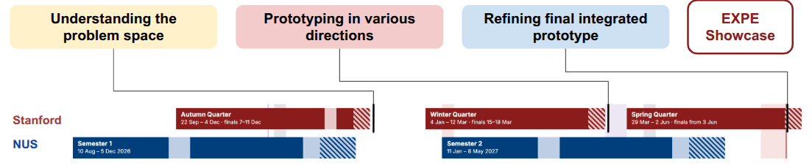
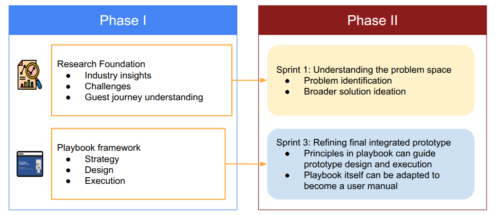

## 7. Conclusion and Next Steps {#conclusion}

### Phase I Achievements

Phase I focused on understanding the challenges surrounding hotel self-service kiosk adoption and developing a structured approach to improving kiosk implementation.

Through industry research, fieldwork, and engagement with hotel stakeholders, we gained valuable insights into hotel operations, guest journeys, and the factors influencing technology adoption. These findings informed the development of an interactive playbook that guides hotel operators through three key stages: **Strategy, Design, and Execution**.

The playbook consolidates our research into a practical decision-support resource, enabling hotel managers to evaluate kiosk suitability, explore placement options, assess financial feasibility, and plan implementation. Positive feedback from industry professionals further highlighted its potential value in supporting more informed planning decisions.

### Transitioning from Phase I to Phase II {#next-steps}

While Phase I focused on improving kiosk implementation, **Phase II will adopt a broader objective of reimagining the hotel guest experience through emerging technologies**. This next phase will be structured around three sprints, aligned with the Stanford ME310 programme timeline, as illustrated below.

The three sprints will focus on:

1. **Understanding the Problem Space:** Identifying key challenges and opportunities within the broader hotel guest experience.
2. **Prototyping in Various Directions:** Exploring and testing different solution concepts to address the identified problems.
3. **Refining the Final Integrated Prototype:** Consolidating findings and refining the most promising concepts into an integrated solution for the EXPE Showcase.

Importantly, Phase II will build upon the work completed in Phase I rather than starting from scratch. As illustrated below, two key outcomes from Phase I will contribute to the next phase.

Firstly, the **research foundation** established in Phase I, particularly our understanding of the hospitality industry, its operational challenges, and the guest journey, will support the first sprint. These insights provide a starting point for identifying underlying problems and exploring opportunities for innovation beyond self-service kiosks.

Secondly, the **playbook framework** developed in Phase I can support the refinement and eventual deployment of the final solution in Sprint 3. Its principles across Strategy, Design, and Execution can guide considerations surrounding technology suitability, user experience, and implementation planning. Furthermore, the playbook itself could be adapted and expanded beyond kiosks to serve as a user manual or implementation guide for the eventual solution.

Ultimately, **Phase I establishes both a research foundation and a practical implementation framework for Phase II**. By building upon these achievements, the project can progress from improving existing kiosk implementations towards developing a more integrated solution that enhances the broader hotel guest experience.
