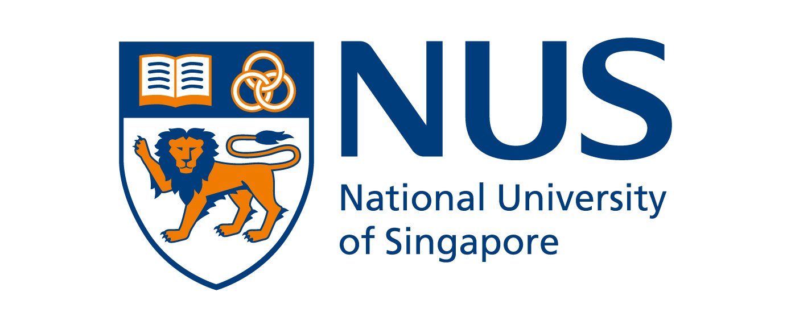

THE DESIGN INVESTIGATION · PHASE I

# Reimagining the Hotel Arrival Experience

**CDE4301 Innovation and Design Capstone · IS-431 Interim Report**  
Stanford GEDI Programme AY2026/27

Read the complete report below, or use the chapter navigation to explore a section. Scroll at your own pace throughout.



















